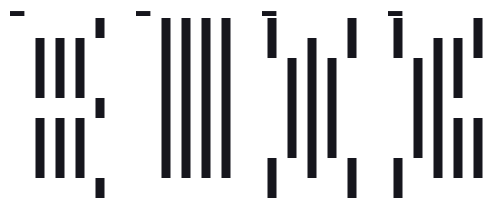
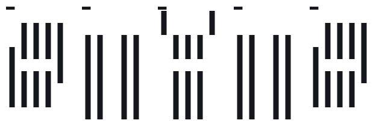

<picture>
  <source media="(prefers-color-scheme: dark)" srcset="assets/hello-dark.svg">
  
</picture>

  <a href="https://a-cup-of.coffee">Blog</a> •
  <a href="https://bsky.app/profile/une-tasse-de.cafe">Bluesky</a>

- 🔭 I’m currently working at [Lucca](https://www.lucca.fr/).
- 🌱 I’m currently learning more on [HCI](https://www.hpe.com/emea_europe/en/what-is/hyperconverged-infrastructure.html), Golang, and better [X-as-code](https://quadralogics.com/research/XAsCode.html) practices.
- 💬 Ask me about **Containers, Kubernetes and Python**
- 📫 How to reach me: [@une-tasse-de.cafe](https://bsky.app/profile/une-tasse-de.cafe) on BlueSky.

       

 -------

<picture>
  <source media="(prefers-color-scheme: dark)" srcset="assets/blog-dark.svg">
  
</picture>

<!-- BLOG-POST-LIST:START -->
- [Under Bluesky&#39;s hood: the ATProto](https://a-cup-of.coffee/blog/atproto-pds/)
- [Karpenter + Cluster API](https://a-cup-of.coffee/blog/karpenter-capi-ovh/)
- [Kloak: kernel-space secret injection via eBPF on Kubernetes](https://a-cup-of.coffee/blog/kloak/)
- [talosctl-oidc: adding SSO to Talos Linux](https://a-cup-of.coffee/blog/talosctl-oidc/)
- [Kairos, the immutable OS for deploying Kubernetes](https://a-cup-of.coffee/blog/kairos/)
<!-- BLOG-POST-LIST:END -->

-------

<picture>
  <source media="(prefers-color-scheme: dark)" srcset="assets/stats-dark.svg">
  
</picture>

Titles set in <a href="https://une-tasse-de-cafe.tngl.io/Orbital/">Orbitale</a> and <a href="https://une-tasse-de-cafe.tngl.io/vacua/">Vacua</a>, two experimental fonts I made.
