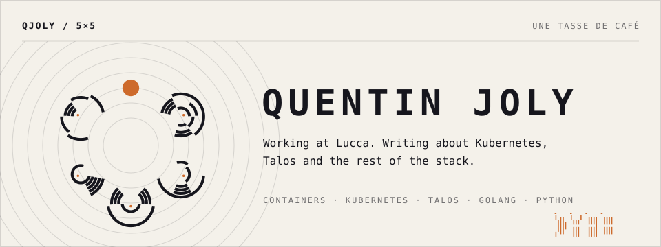
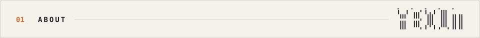
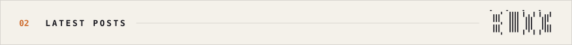
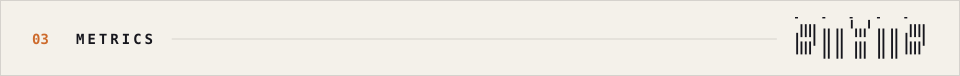

  

  <a href="https://a-cup-of.coffee"><code>a-cup-of.coffee</code></a> ·
  <a href="https://bsky.app/profile/une-tasse-de.cafe"><code>@une-tasse-de.cafe</code></a> ·
  <a href="https://une-tasse-de-cafe.tngl.io/Orbital/"><code>orbitale</code></a> ·
  <a href="https://une-tasse-de-cafe.tngl.io/vacua/"><code>vacua</code></a>

<table>
  <tr><td><b>Now</b></td><td>Working at <a href="https://www.lucca.fr/">Lucca</a></td></tr>
  <tr><td><b>Learning</b></td><td><a href="https://www.hpe.com/emea_europe/en/what-is/hyperconverged-infrastructure.html">HCI</a>, Golang, better <a href="https://quadralogics.com/research/XAsCode.html">X-as-code</a> practices</td></tr>
  <tr><td><b>Ask me about</b></td><td>Containers, Kubernetes, Python</td></tr>
  <tr><td><b>Stack</b></td><td><code>Proxmox</code> <code>Kubernetes</code> <code>Talos</code> <code>Terraform</code> <code>Packer</code> <code>Ansible</code> <code>Consul</code> <code>Vault</code> <code>Prometheus</code></td></tr>
</table>

<!-- BLOG-POST-LIST:START -->
- [Under Bluesky&#39;s hood: the ATProto](https://a-cup-of.coffee/blog/atproto-pds/)
- [Karpenter + Cluster API](https://a-cup-of.coffee/blog/karpenter-capi-ovh/)
- [Kloak: kernel-space secret injection via eBPF on Kubernetes](https://a-cup-of.coffee/blog/kloak/)
- [talosctl-oidc: adding SSO to Talos Linux](https://a-cup-of.coffee/blog/talosctl-oidc/)
- [Kairos, the immutable OS for deploying Kubernetes](https://a-cup-of.coffee/blog/kairos/)
<!-- BLOG-POST-LIST:END -->

  Set in <a href="https://une-tasse-de-cafe.tngl.io/Orbital/">Orbitale</a> and <a href="https://une-tasse-de-cafe.tngl.io/vacua/">Vacua</a>, two experimental fonts I made · <code>node assets/build.mjs</code> redraws the artwork
  

